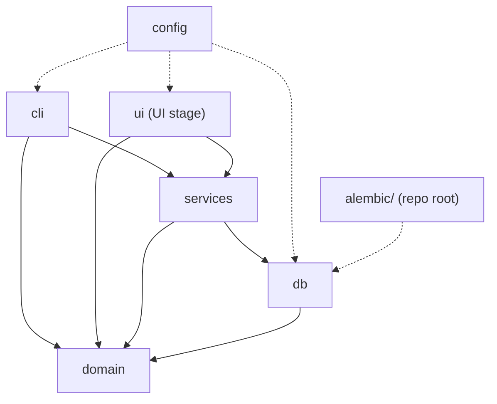
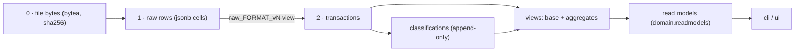
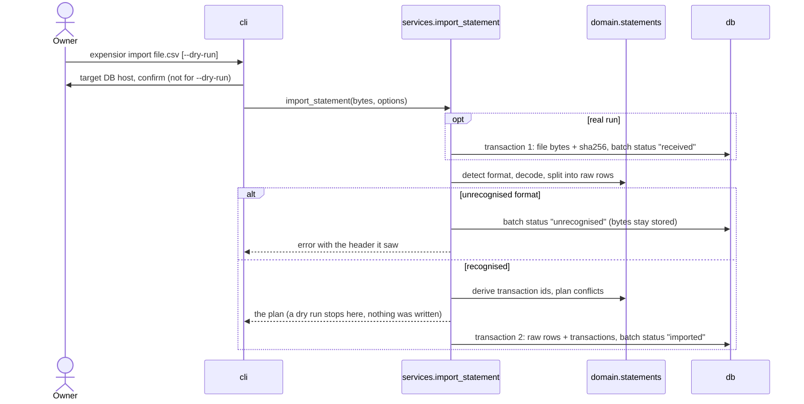

# 0009: Code structure — a `src/` package in layers with one-way dependencies

- **Status:** Accepted — after the owner's review and the stage 0 skeleton; to be re-checked after stage 2
- **Date:** 2026-11-09

## Context

There is no application code yet. The structure has to serve three earlier decisions:

- [ADR 0003](0003-ui-keyboard-first-htmx.md): the UI is a **thin, replaceable layer** — NiceGUI today, possibly a
  Vue SPA later — with no domain logic in it.
- [ADR 0007](0007-transformations-elt-in-postgres.md): domain logic (parsing, identity, conflict policy, rules
  engine) is **pure Python**, aggregates are **SQL views**, and the import keeps the **original file bytes**.
- The legacy app scattered SQL across endpoints and ran row-by-row logic in pandas
  ([legacy notes](../domain/legacy-expensior.md)) — the thing this structure must make hard to repeat.

[`conventions.md`](../guides/conventions.md) said "flat layout, no `src/`", but no ADR argued for it, and both
of the owner's other projects use `src/` (`menu_delivery`; `gcloud-web`, whose ADR 0003 gives the reason: in a flat
layout, tests can import the working directory instead of the installed package, so they pass while the installed
thing is broken).

## Decision

### Layout

```
src/expensior/
  config.py            # Settings (pydantic-settings): DATABASE_URL, ...
  logging.py           # structured JSON logs (ADR 0002)
  domain/              # pure Python — no I/O, no database, no framework
    types.py           #   TransactionId, Money (Decimal), enums (ImportStatus, ConflictPolicy, ...)
    statements/        #   everything about a bank statement, as pure functions
    rules/             #   the rules engine
    categories.py      #   category tree: path, move without cycles
    readmodels.py      #   frozen dataclasses for what the views return (TransactionRow, MonthlyCashflow, ...)
  db/                  # persistence
    models.py          #   SQLAlchemy 2.0 typed models
    session.py         #   engine and session factory, from config
    unit_of_work.py    #   one database transaction, exposing the repositories
    repositories/      #   batches, raw_rows, transactions, categories, rules, classifications
    queries/           #   reads from the SQL views, returning domain.readmodels
  services/            # use cases; the only place that opens a transaction
  cli/                 # command-line entry point (`expensior ...`)
  ui/                  # added in the UI stage; framework-specific
alembic/               # repo root: migrations, including the SQL views (ADR 0007)
tests/                 # mirrors the package
infra/  docs/          # repo root, as before
```

`alembic/`, `tests/`, `infra/` and `docs/` stay at the repository root, as already settled.

### Layers and the one rule of dependencies

| Layer | Contains | May import | Must not import |
|---|---|---|---|
| `domain` | types, statement parsing, rules engine, category tree, read models | stdlib, Pydantic | anything else in the package, SQLAlchemy, a UI or web framework, `config` |
| `db` | models, repositories, view queries, unit of work | `domain`, `config` | `services`, `cli`, `ui` |
| `services` | use cases: import, undo, reprocess, classify, reclassify, dashboard queries | `domain`, `db` | `cli`, `ui` |
| `cli`, `ui` | argument parsing / screens, formatting | `services`, `domain` (read models, types), `config` | `db` |



Rules that follow from it:

1. **Dependencies point one way**, toward `domain`. `domain` knows nothing about the rest.
2. **`domain` is pure.** It takes values and returns values: no database, no file system, no clock or randomness
   hidden inside — a caller passes them in. Everything in it is unit-tested without a database.
3. **Only `services` open a transaction** (through the unit of work) and hand repositories to domain calls.
   Repositories never commit; the UI and CLI never touch `db` — that is what keeps the UI replaceable.
4. **`domain` defines the types its logic needs; it does not mirror every table.** Repositories map ORM rows to
   those types (for example the minimal input the rules engine classifies). Plain data, no ORM objects, crosses
   a layer boundary upwards.
5. **Read models live in `domain/readmodels.py`**, so `db` can return them, `services` can pass them through, and
   `ui`/`cli` can use them, without anyone importing a type from a layer above.
6. **The rules are enforced, not remembered:** an import-linter contract (a dev dependency) that fails CI when a
   layer imports what it must not.

### Data layers and where they live in code



| Concern | Code |
|---|---|
| Original bytes, batch status | `db/models.py` (`ImportBatch`), `db/repositories/batches.py` |
| Format detection, decoding, raw rows, identity, conflict plan | `domain/statements/` (pure) |
| Raw cells → typed columns | a view per format version, in an Alembic migration |
| Classification rules and history | `domain/rules/` (engine), `db/repositories/classifications.py` (append-only, partial unique index "one current") |
| Dashboard numbers | views in Alembic migrations; `db/queries/` reads them; `services/dashboard.py` picks the view and the `WHERE` parameters |

### What is in each package

Names are provisional and settle as the code is written; the responsibilities are the decision.

**`domain/statements/`** — pure functions over bytes and values:

| Module | Responsibility |
|---|---|
| `formats.py` | registry: header signature → `format_version` (`pko_bp` v1, …); "unrecognised" is a result, not an exception |
| `decoding.py` | bytes → text: encoding detection, mojibake repair |
| `raw.py` | `RawBatch` / `RawRow`: the header and the cells as text, no interpretation |
| `identity.py` | stable `transaction_id` from the raw cells (long hashes, per legacy lessons) |
| `plan.py` | `ConflictPolicy` (`ignore \| replace \| abort`) and `ImportPlan`: incoming ids + existing ids → what would be inserted, skipped, replaced |

**`domain/rules/`**: `conditions.py` (typed Pydantic conditions), `engine.py` (priority order, first match wins, only
unclassified input), `validation.py` (a regex is validated when a rule is saved).

**`db/`**: `repositories/` hold all SQL access (the legacy lesson: a repository layer from day one);
`queries/` read the views; `unit_of_work.py` bundles one session with its repositories.

**`services/`**: `import_statement`, `reprocess_batch`, `undo_batch`, `classify`, `reclassify` (manual and bulk),
`categories`, `rules`, `transactions`, `dashboard`.

**`cli/`**: `main.py` (the `expensior` script, declared in `pyproject.toml`), one module per command group, and
`confirm.py`, which prints the target database host and asks before any write (a rule in `AGENTS.md`).

### The import, end to end



- **A dry run writes nothing**, not even the bytes. It reads existing ids from the database and prints the plan.
- **The bytes are committed before parsing**, in their own transaction, so they survive a parser failure. Raw rows
  and transactions are then written together in a second transaction: all of it or none.
- **Reprocessing** (`reprocess_batch`) runs the same pipeline from the stored bytes. Because `transaction_id` is
  deterministic, re-derived transactions keep their ids and the manual classifications attached to them survive;
  what happens when a fixed parser changes an id is settled in the import stage.

### Tests

`tests/` mirrors the package. `tests/domain/` — fast unit tests, no database, the bulk of the suite.
`tests/db/` and `tests/services/` — against a real Postgres (the one from `docker compose` locally, a service
container in CI), including the SQL views. `tests/cli/` — thin. Fixtures are synthetic CSVs only
([`AGENTS.md`](../../AGENTS.md)).

## Alternatives considered

| Option | Why not |
|---|---|
| Flat layout (package at the repo root) | Tests can import the working directory instead of the installed package; both of the owner's other projects use `src/`; `uv init --package` creates it by default. The cost of `src/` is one directory level |
| Vertical slices (`imports/`, `rules/`, `dashboard/`, each with its own model, SQL and logic) | Reads well per feature, but the views are shared across features, and the "pure domain, replaceable UI" rule becomes a convention in every slice instead of a boundary the structure enforces |
| Ports and adapters with interfaces (`Protocol`s) for every repository | One database, one UI at a time — abstractions for swaps that will not happen. Concrete repositories are enough; the real swap point is the UI, and that is already behind `services` |
| No repository layer — SQL in the services | It is what the legacy app did (SQL in every endpoint), and it makes services hard to test |
| ORM models used everywhere, no domain types | The rules engine and the parser would depend on SQLAlchemy and could no longer be tested without it |

## Consequences

- Good: the pure core is unit-testable without a database; replacing the UI touches only `ui/` (and a thin `api/`
  package if the Vue plan B is taken); a new bank format means a new module in `domain/statements/` plus a view;
  one import path for tests and for the installed package.
- Bad / accepted risks:
  - Mapping between ORM rows and domain types is code that a direct-ORM design would not have. Kept small by rule 4
    (only the types the logic needs).
  - A layered structure means a use case touches several packages; a small feature is several small edits.
  - View SQL in migrations is outside mypy and ruff (already accepted in ADR 0007).
- Open — to settle when the code exists, not now:
  - CLI library: the skeleton uses stdlib `argparse`; revisit if the commands multiply.
  - How the unit of work is spelled (a context manager on a session, or an explicit object).
  - What `reprocess_batch` does when a corrected parser derives a different `transaction_id`.
- Follow-ups: the module tables and the three diagrams are the raw material for `docs/architecture.md`, to be
  written once the first stages exist. Re-check this ADR after stage 2 shows how it holds. The layer rules are
  enforced from the skeleton on by the import-linter contracts in `pyproject.toml`.
