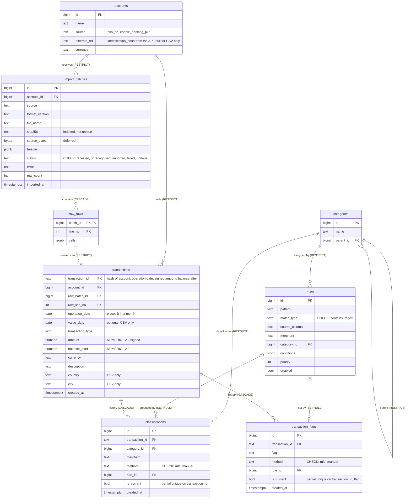

# 0010: Database schema — accounts, three layers, append-only classification history

- **Status:** Proposed
- **Date:** 2026-11-13

## Context

The schema is where the earlier design of expensior (legacy) and the new one differ most, and it is expensive to
change once data is in it. [ADR 0007](0007-transformations-elt-in-postgres.md) fixes the layers (file bytes, raw
rows, transactions). The spike in [#12](https://github.com/terleckimaciej/expensior-v2/issues/12)
([findings](../research/enable-banking-pko-2026-11.md)) added facts the first draft of the schema did not have:

- the owner's bank session returned **two accounts**, and a fifth of all transactions are transfers between own
  accounts (`AUTOSAVER`), so "the account" cannot be implicit;
- the balance after a transaction only makes sense within one account, and it is part of the transaction id;
- a transaction must be traceable to the raw row it came from, or "reprocess after a parser fix" has nothing to
  start from.

This ADR records the schema as a whole, with the reasons, so the choices are not taken on trust from legacy.

## Decision

The label in brackets is the foreign key's `ON DELETE` rule: `CASCADE` deletes the child rows too, `RESTRICT`
refuses to delete a parent that still has children, `SET NULL` keeps the child and clears the reference.

**Three layers, as in ADR 0007.** `import_batches` holds the original bytes (a file or an API response) before
anything is parsed; `raw_rows` holds one row per line or per API transaction, untouched, as `jsonb`;
`transactions` is derived from a raw row by the adapter for its format. A transaction points at its raw row
(`raw_batch_id`, `raw_line_no`), so any transaction can be traced to what actually arrived and rebuilt from it.
Deleting a batch deletes its raw rows (`CASCADE`), but a raw row that has a transaction cannot go (`RESTRICT`),
so a batch with transactions cannot be deleted by accident; undoing a batch is a deliberate service operation.

**Accounts are explicit.** Every batch and every transaction belongs to one account (`NOT NULL`). A CSV does not
say which account it is from, so the importer is told. The API account is recognised by `external_ref`, the
`identification_hash` the API returns. Transfers between own accounts are marked with a flag, not a separate
table.

**One id for a transaction, whichever source it came from** ([ADR 0007](0007-transformations-elt-in-postgres.md)):
`transaction_id` is a hash of the account, the operation date, the signed amount and the balance after. It is the
primary key, so an idempotent import is enforced by the database. In the spike's data (2658 transactions) the
key had no collisions. A theoretical collision is two zero-amount transactions on one day with the same
balance; the conflict policy would ignore the second, and no such transaction was in the data.

**Classification stays as it is: deterministic rules, manual corrections, an append-only history.** A new
classification adds a row and marks the previous one not current; a partial unique index on
`(transaction_id) WHERE is_current` makes "one current classification" a rule of the database. Flags work the
same way, one current row per transaction and flag. A transaction without a classification is a valid state.
`method` is `rule` or `manual`; another value (for example a suggestion) is one `CHECK` change, so nothing here
blocks it.

**Conventions.** Money is `NUMERIC(12,2)` (never float) and signed: debits are negative, as in both sources.
Dates are `date`, timestamps `timestamptz`. Enumerations are `text` with a named `CHECK`, not Postgres enums,
because a new value is then a constraint change instead of a type migration. Categories are a parent column with
`UNIQUE NULLS NOT DISTINCT (parent_id, name)`, so two root categories cannot share a name. `source_bytes` is
loaded on demand only, because a stored API response is megabytes and an ordinary read of a batch should not
pull it. `import_batches.sha256` is indexed but not unique, because the same file may be imported again after an
undo.

## Alternatives considered

| Option | Why not |
|---|---|
| No accounts table; one implicit account | Two accounts already exist, the balance and the id depend on the account, and adding it later means rewriting ids and moving data |
| `account_id` nullable | The balance chain and the id are only consistent with an account; a nullable column makes both ambiguous |
| A surrogate `bigint` id for transactions plus a unique index on the hash | Cleaner foreign keys, but idempotency would no longer be guaranteed by the primary key itself; at this volume the text key costs nothing |
| A transaction that knows only its batch (`import_batch_id`) | It cannot say which raw row it came from, so a reprocess after a parser fix would need a fragile match back to the row |
| Updating the current classification in place | Loses the history; classification history is append-only by project rule |
| A closure table or nested sets for categories | Two levels (category and subcategory) do not justify it; a parent column is enough |
| A separate `subcategories` table | Two tables for one idea and the same lookups twice |
| Postgres `ENUM` types | Adding a value needs a type migration; `text` with a `CHECK` is easier to change |
| A trained model (for example TF-IDF with logistic regression) for classification | About 2,600 transactions give little to learn from; results are hard to explain; it adds a dependency. Can be added later without a schema change |
| An LLM proposing categories for unknown merchants | Sends descriptions (merchant names, for transfers real names) to a third party, which needs its own privacy decision. Deferred; it would be a new `method` value |

## Consequences

- Good: the database enforces what used to be convention (one current classification, no duplicate root
  category, no orphaned history, no batch deleted while it has transactions); every transaction can be traced
  to the bytes it came from; a second account or a second source needs no schema change.
- Bad / accepted risks:
  - The hash of the id means the importer, not the database, computes the primary key; a bug in it is a bug in
    idempotency, so the importer's tests carry that weight.
  - Transactions seen in both sources keep the raw row of the first import; the second source's raw row has no
    transaction.
  - Two accounts show an own-account transfer as an outflow and an inflow until it is flagged.
- Follow-ups:
  - A view that excludes flagged own-account transfers from spending (stage 4).
  - How much of the API response to store on each refresh: [#14](https://github.com/terleckimaciej/expensior-v2/issues/14).
